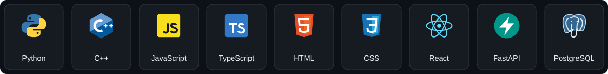
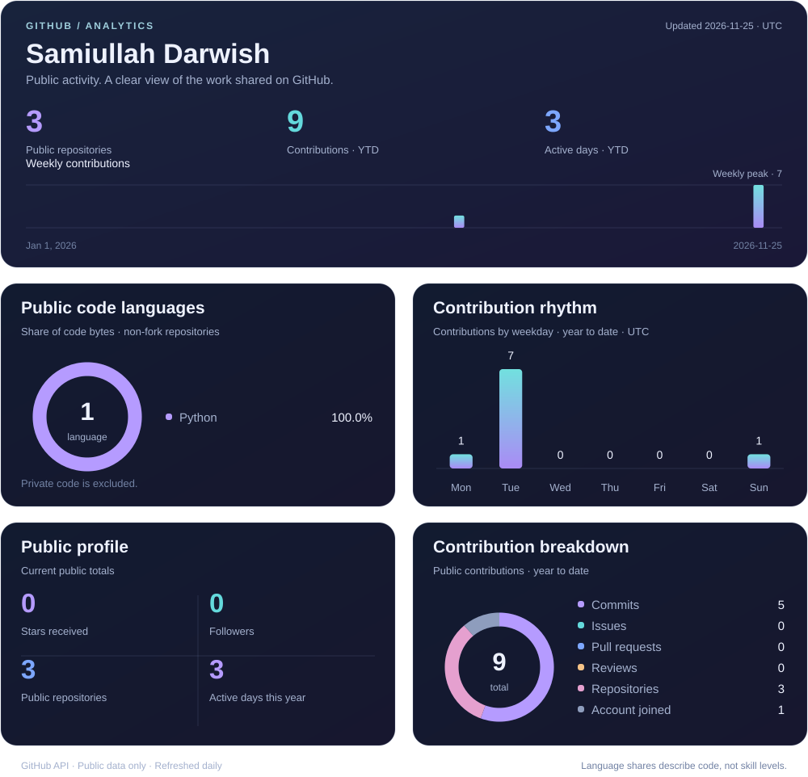

## 🎯 About Me

<picture>
  <source media="(max-width: 600px)" srcset="assets/about-mobile.svg">
  
</picture>

<details>
<summary>Profile details</summary>

```javascript
const samiullah = {
  role: "Software Developer",
  location: "Afghanistan",
  languages: [
    "Python", "C++", "JavaScript",
    "TypeScript", "HTML", "CSS"
  ],
  frontend: ["React", "TypeScript"],
  backend: ["Python", "FastAPI"],
  database: "PostgreSQL"
};
```

</details>

## 🔗 Connect With Me

<p align="center">
  <a href="https://samiullah-darwish.pages.dev/"></a>
  <a href="mailto:samiullah.darwish89@gmail.com"></a>
  <a href="https://github.com/samiullahdarwish89-cmd?tab=repositories"></a>
</p>

## 🛠️ Tech Stack

<picture>
  <source media="(max-width: 600px)" srcset="assets/tech-stack-color-mobile.svg">
  
</picture>

## 📊 GitHub Analytics

<picture>
  <source media="(max-width: 600px)" srcset="assets/github-analytics-mobile.svg">
  
</picture>

<sub>Public activity only · [Source data and update date](assets/github-public-data.json) · [How the charts update](PROFILE-MAINTENANCE.md)</sub>
